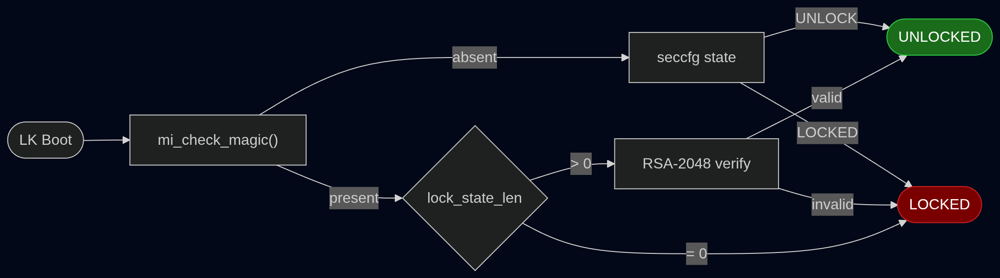

# Xiaomi MTK Bootloader Unlock — HyperOS/MIUI14+ RPMB Bypass

**Scope:** Xiaomi MTK devices with Kamakiri BROM access; compatibility is LK-build-specific and not universal
**XDA Thread:** [xdaforums.com/t/4784527](https://xdaforums.com/t/4784527/)  
**Author:** [Jz8root](https://github.com/Jz8Root)

---

## The Problem

On affected MIUI 14 and HyperOS builds, `mtkclient da seccfg unlock` can succeed
without errors while the bootloader remains locked after reboot. The current
hardware evidence is tracked in this repository rather than inferred from old
device lists: `earth`/MT6769 eMMC ([#8][i8]), `fire`/MT6769Z eMMC
([issue #10](https://github.com/Jz8Root/xiaomi-hyperos-bootloader-unlock/issues/10)),
MT6877 devices ([issue #11](https://github.com/Jz8Root/xiaomi-hyperos-bootloader-unlock/issues/11),
[#13][i13]) and `agate`/MT6893
([issue #14](https://github.com/Jz8Root/xiaomi-hyperos-bootloader-unlock/issues/14)).
These reports do not all share one root cause, which is why the procedure is
gated on both LK analysis and live RPMB state.

## Root Cause

After reverse engineering the Little Kernel (LK) bootloader from HyperOS using Ghidra, I found that Xiaomi introduced a **dual-layer lock verification**:

Starting with HyperOS, Xiaomi stores a magic string in the **RPMB** (Replay Protected Memory Block). The LK reads it before falling back to seccfg — when present, RPMB overrides seccfg even if seccfg says UNLOCK.


**The fix:** erase the RPMB magic. This forces the LK to fall back to seccfg, which mtkclient can freely write to UNLOCK.

**Why it persists across reboots on confirmed devices:** on the Tier 1 devices (MT6781, MT6769Z, MT6833), no boot stage restores the magic once seccfg has been set to UNLOCK, so the erase holds and the device boots to the unlocked state. RPMB dumps taken days or weeks after the original unlock still show the magic region zeroed. See [proof/VERIFICATION.md](proof/VERIFICATION.md) for dump evidence.

**Where this does not hold:** on the measured MT6877 `rubypro` and `pissarro` reports, and on `earth` (Redmi 12C, MT6769Z eMMC), the RPMB procedure ends with fastboot still locked. Dump-level tests on `rubypro` and `earth` show why: the erase reaches flash and survives a reset plus cold BROM re-entry, but the normal boot chain restores the 8 magic bytes. `pissarropro` has a separate matching failure report without the same dump-level trace. The exact writer (preloader, another loader, ATF/TEE or LK) has not yet been isolated. These devices are listed in [COMPATIBILITY.md](COMPATIBILITY.md) under Tier 3b (investigation open, no bypass yet).



| Lock State Value | Meaning |
|-----------------|---------|
| 1 | DEFAULT (RPMB not initialized, fallback to seccfg) |
| 3 | UNLOCKED |
| 4 | LOCKED |

## The Method

The procedure depends on whether your specific LK binary implements the RPMB magic check.
**Don't assume — scan your LK first.** Two devices with the same codename and same SoC can
ship different LK builds with different lock implementations.

### Prerequisites

- [mtkclient](https://github.com/bkerler/mtkclient) with Kamakiri BROM exploit
- Access to BROM mode (see [Entering BROM Mode](#entering-brom-mode) below for the precise procedure)
- Quality USB DATA cable (not charge-only)
- **A USB 2.0 port.** Not USB 3.0. See below, this one silently ruins runs.
- **MANDATORY:** Full backup of NV partitions (commands below)

<a id="use-a-usb-20-port-never-usb-30"></a>

### Use a USB 2.0 port; avoid USB 3.x for writes

At least one `earth` report showed RPMB and seccfg writes acknowledged through a USB 3.x host
controller without the expected state change. The tool printed `Successfully wrote seccfg`, the
operation looked correct, and the flags remained unchanged. This is a host/device observation,
not a claim that every USB 3.x controller universally drops MTK writes.

The signature is unmistakable once you know it: every command reports success, and every flag is
exactly as it was before you started.

```
fastboot oem lks           -> lks = 1        unchanged
fastboot getvar unlocked   -> unlocked: no   unchanged
fastboot getvar secure     -> secure: yes    unchanged
```

Observed on earth/MT6769Z in [#8][i8], where the reporter had switched to the blue port without
realising. Later tests on another earth device also found a separate early-boot restoration block,
so USB transport failure and Tier 3b restoration must not be conflated. Use a known USB 2.0 path
for writes, and prefer a direct connection over an unpowered hub.

Two traps worth knowing:

- some laptops have a physically black port that is **internally wired to the xHCI 3.0
  controller** anyway, through sloppy board routing. If a second attempt on the same port fails
  the same silent way, try a different port, a USB 2.0 hub, or another machine entirely
- USB-C ports are almost always 3.x. Prefer a USB-A 2.0 port with an A-to-C cable

**Always verify by re-reading the RPMB, never by trusting the log line:**

```bash
python mtk.py da rpmb r rpmb_check.bin
grep -boa "Jz8PNRUF" rpmb_check.bin
```


### Linux Pre-flight

On any modern Linux distro that ships with `ModemManager` and the `option` USB-serial driver
(Manjaro, Arch, Ubuntu, Fedora, openSUSE, etc.), mtkclient sessions silently fail with
`DaHandler - Please disconnect, start mtkclient and reconnect.` even though the udev rules
from `Setup/Linux/` are installed correctly.

The root cause is in `dmesg` immediately after the phone enters BROM:

```
usb 1-1: New USB device found, idVendor=0e8d, idProduct=0003
usb 1-1: GSM modem (1-port) converter now attached to ttyUSB0
```

The kernel's `option` driver (via `usb_wwan`/`usbserial`) claims the MediaTek port instantly on
enumeration and blocks libusb's `CLAIM_INTERFACE`. ModemManager grabs anything that looks like a
modem. mtkclient's udev rules grant userspace access but don't prevent kernel-driver binding.

**Run this before each mtkclient BROM session:**

```bash
sudo systemctl stop ModemManager
sudo modprobe -r option usb_wwan

# verify
lsmod | grep -E '^option|^usb_wwan' || echo "ok — modules unloaded"
systemctl is-active ModemManager   # should print: inactive
```

`usbserial` is built into the kernel on most distros — you don't need to (and can't) unload it.
Only `option` and `usb_wwan` matter.

The modules can auto-reload on udev events between sessions. If a later command fails with the
same `Please disconnect, start mtkclient and reconnect.` symptom, re-run the `modprobe -r` step.

When you're done with the unlock, restore the normal modem stack:

```bash
sudo systemctl start ModemManager
# option/usb_wwan will re-load automatically on next USB modem connect, or after reboot
```

### Entering BROM Mode

BROM is the boot-ROM USB-download mode that runs *before* the preloader. It only stays active if
the volume keys are held during its ~100 ms startup window — and that window is **before USB power
arrives**, not after. If you plug first and press keys after, BROM has already handed off to
preloader → LK, and the keys then trigger fastboot or recovery instead.

**The procedure that works reliably:**

1. **Phone fully off.** Not transitioning. Not in fastboot. Not displaying a logo. If unsure,
   hold Power for 15 s to force-off, then wait 5 s. This is fine **before** you start, but once
   the RPMB is erased the Power button is off limits, see
   [the rule below](#never-use-the-power-button-between-the-rpmb-erase-and-seccfg-unlock).
2. **USB unplugged.**
3. Press and hold **Vol+ AND Vol−** (both, simultaneously). On some devices Vol+ alone or
   Vol− alone works; try both keys first.
4. **While still holding the keys**, plug the USB cable in.
5. Keep holding **for 15+ seconds** after the cable is in.
6. Release.

**The screen must stay completely black throughout.** If you see anything — Xiaomi logo,
"FASTBOOT" text, the unlocked-warning screen, a vibration — the timing was wrong. Unplug,
force-off, retry.

**If this happens after an RPMB erase**, the normal boot chain has run and may have restored the magic.
Re-dump to confirm, redo the erase, and retry the BROM entry using only the volume keys. See
[the rule below](#never-use-the-power-button-between-the-rpmb-erase-and-seccfg-unlock).

> **mtkclient should already be running before you plug in.** Start `mtk.py r ...` /
> `mtk.py da rpmb r ...` / `mtk.py da seccfg unlock` first — it will print
> `Waiting for PreLoader VCOM, please reconnect mobile/iot device to brom mode` and sit there
> until USB enumeration happens. That way mtkclient grabs the device in the first ~100 ms after
> enumeration, before any kernel driver can race for the interface.

**Between every `da` command, the phone needs a fresh BROM entry.** Unplug, redo the key combo,
replug.

#### Never use the Power button between the RPMB erase and seccfg unlock

🚨 This is the single most important rule in this document, and it is the reason most reported
failures fail.

**The early boot chain can rewrite the RPMB magic on start-up.** Reaching the Mi logo is enough.
So anything that starts the phone between your erase and your unlock can silently undo the erase,
and nothing tells you. The exact writer is still under investigation; the operational rule does
not depend on which boot stage performs the write.

Re-entering BROM does **not** start the phone, so it is safe:

| Action | Safe? | Why |
|-|-|-|
| unplug, hold Vol+ and Vol-, replug | ✅ | BROM only, the normal boot chain never runs |
| Power button to shut down or restart | ❌ | normal boot starts, magic may be rewritten |
| letting the Mi logo appear at all | ❌ | the boot chain has already run |
| `fastboot reboot` | ❌ | same |

So the erase and the unlock are two ordinary BROM sessions, with a normal unplug and key-combo
in between. Nothing exotic is required:

```bash
python mtk.py da rpmb e --sector <YOUR_SECTOR> --sectors 4
#   unplug, hold Vol+ and Vol-, replug. Do not touch the Power button.
python mtk.py da seccfg unlock
```

**How this was established.** LucaCraft89 ([#13][i13]) ran three dumps on rubypro/MT6877. After the
erase and a full cold BROM re-entry with Kamakiri re-run and the DA re-uploaded, the magic was
**gone**. He then allowed a normal start-up, re-read, and the magic was **back**. vivaad ([#8][i8])
later isolated the same boundary on earth/eMMC: the sector stayed zero after `mtk.py reset` and a
cold BROM re-entry, then exactly the 8 magic bytes returned after reaching the Mi logo. This proves
the writer runs during the normal boot chain, but does not by itself identify which stage writes it.

**Why the phone sometimes ends up in a strange state:** after `da rpmb e` completes, mtkclient
calls neither `close()` nor `shutdown()`. The command returns and leaves the device with the DA
still running and still powered. On some units the Power button then reboots instead of shutting
down, which is how katavnnn ([#12][i12]) first ran into this on sea/MT6781.

##### If the phone gets stuck and you need to reset it

Stuck in an intermediate MTK state (e.g. `0e8d:20ff` not recognised by mtkclient, or fastboot
wedged after a killed mtkclient run)? Three options, least invasive first. **None of them are
needed in the normal flow** where you simply unplug and redo the key combo.

- **Reset the USB endpoint without unplugging**, which does not touch the phone's power state:
  ```bash
  sudo python3 -c "import os, fcntl; fcntl.ioctl(os.open('/dev/bus/usb/BBB/DDD', os.O_WRONLY), 21780, 0)"
  ```
  (replace `BBB/DDD` with the bus/device numbers from `lsusb`).
- **`python mtk.py reset`** issues a DA shutdown with `bootmode=0`. It works on some units and
  fails on others with `DeviceClass - [Errno 2] Entity not found`, and note that the
  `Reset command was sent` message is printed unconditionally by mtkclient whether or not the
  command actually went through, so it is not a confirmation.
- **Disconnect the battery connector** from the board, reconnect, then hold Vol+ and Vol- before
  inserting the cable. Proven on hardware by katavnnn ([#12][i12]) and it cannot start the phone
  by accident, but it means opening the back cover. Last resort.
  
### Step 0 — Mandatory backups

In BROM, dump everything that matters before any write operation:

```bash
# Critical partitions in one BROM session (sizes are mtkclient's uniform read, real content at the start)
python mtk.py r \
  nvdata,nvcfg,nvram,persist,protect1,protect2,seccfg,lk_a,lk_b,boot_a,boot_b \
  nvdata.bin,nvcfg.bin,nvram.bin,persist.bin,protect1.bin,protect2.bin,seccfg.bin,lk_a.bin,lk_b.bin,boot_a.bin,boot_b.bin

# RPMB (separate BROM session — phone must re-enter BROM between sessions)
python mtk.py da rpmb r rpmb_backup.bin
```

Without `nvdata` / `nvcfg` / `nvram` / `protect*` you risk "NV data corrupted" → bricked
IMEI and baseband. Keep these backups for months — they're your recovery path.

### Step 1 — Identify your LK with `scan_lk.py` ⟵ DECISION POINT

**Scan both slots — they can differ.** After an OTA update, slot A and slot B can carry different LK builds. Confirmed independently on Redmi 12 (`fire`, HyperOS 2.0) and POCO M4 Pro 4G (`fleur`, HyperOS 1.0.2.0): in both reports `lk_a = COMPATIBLE_SECCFG_ONLY` while the active `lk_b = COMPATIBLE_FULL`. The device boots on the active slot — use that result.

```bash
python3 scan_lk.py lk_a.bin
python3 scan_lk.py lk_b.bin
# Use the result matching your active slot (check: fastboot getvar current-slot)
```

The verdict drives which path you take:

| Verdict | Meaning | Path |
|-|-|-|
| `COMPATIBLE_FULL` | Known magic and seccfg support are present in LK; live RPMB initialization is not proven by the binary alone | **Path A candidate** below |
| `COMPATIBLE_SECCFG_ONLY` | Known magic and contradictory `mi_get_lock_state` signal are absent | **Path B candidate** below |
| `MAYBE` / `UNKNOWN` | Evidence is incomplete or contradictory. Investigate manually and share `scan_lk.py --json` | neither |

> **Do not read the Path B score as a confidence level.** A `COMPATIBLE_SECCFG_ONLY` verdict
> tops out at **44/100 by construction**, because 47 of the 100 points are the magic string
> that a Path B device does not have, and the `mi_check_magic` check keys off that same
> string. A 31/100 Path B verdict is not a weak result: the absent magic *is* the finding.
> Only Path A verdicts should be read against the 0-100 scale. A `MAYBE` verdict with
> `mi_get_lock_state` is different: issue #10 shows that contradictory RPMB signals must be
> investigated rather than treated as ordinary Path B.

> Older fleur units (and other "HyperOS-eligible" devices) ship the MIUI-13-era LK
> that Xiaomi never updated. On those, the RPMB lock layer simply isn't implemented
> and the destructive RPMB erase step is unnecessary. The scanner is the only
> reliable way to tell from outside.

### Path A — `COMPATIBLE_FULL` (known RPMB mechanism in LK)

Three commands, one BROM cycle each:

**⚠️ Before erasing: locate the live RPMB magic first.** Its mapping depends on
the LK/storage driver family and cannot be inferred safely from the SoC name.
Dump your RPMB and grep for the magic string:

```bash
python3 mtk.py da rpmb r rpmb_dump.bin
grep -boa "Jz8PNRUF" rpmb_dump.bin
# byte_offset / 256 = your sector
# Known: MT6781/MT6769Z = 57344 | MT6833 gold = 65504 | MT6833 light = 57344
# MT6833 varies by LK family: do not assume 65504, always grep. Unknown SoC: use grep result.
```

**If grep returns more than one offset, they are not separate copies.** The dump mtkclient
produces is larger than the physical RPMB, so the same location shows up several times. Hits
separated by exactly 16 MiB (`0x1000000`) are aliases of each other, because the address field in
an RPMB frame is two bytes and therefore wraps at 65536 sectors:

```
122880 mod 65536 = 57344      same physical location, seen twice
```

Erase the **lowest** offset of each aliased pair, once. On rubypro, grep returns `14680064` and
`31457280`, which is sector 57344 and its 16 MiB alias, so only 57344 gets erased. On miel it
returned four hits collapsing to two real locations (16352 and 57344), and 57344 alone was
sufficient.

Then erase the sector you found:

```bash
# STEP A1: Erase RPMB magic region (replace <YOUR_SECTOR> with grep result above)
python mtk.py da rpmb e --sector <YOUR_SECTOR> --sectors 4

# STEP A2: Unlock seccfg
python mtk.py da seccfg unlock
```

(Step 0 already produced the mandatory `rpmb_backup.bin`.) **Between every `da` command,
the phone needs a fresh BROM entry**: unplug, redo the key combo, replug.

**A1 and A2 are the critical pair.** If the phone boots between them, the magic can come back, and
A2 then unlocks a seccfg that the restored magic will override on the next boot. **Never touch the
Power button in this window.** Unplug and redo the key combo, that is all that is needed. See
[the rule above](#never-use-the-power-button-between-the-rpmb-erase-and-seccfg-unlock).

If your device needs a specific preloader, add `--preloader preloader_CODENAME.bin` to each command.

**Note on the erase:** only 4 sectors are touched — just the magic region. Absent magic alone forces
the DEFAULT→seccfg fallback path.

#### If you re-dump to check the erase, do it in a separate cold session

⚠️ A `da rpmb r` issued without a cold DA shutdown in between can reattach to the still-live DA
session and return a **volatile view** in which the magic already looks erased, whether or not
anything reached the flash. That is a false positive, and it is convincing enough to make you
believe the erase worked when it did not.

```bash
# WRONG: chained read, may show a magic that is not actually gone
python mtk.py da rpmb e --sector <YOUR_SECTOR> --sectors 4
python mtk.py da rpmb r rpmb_check.bin

# RIGHT: DA shutdown, cold BROM entry, then read without a normal boot
python mtk.py da rpmb e --sector <YOUR_SECTOR> --sectors 4
python mtk.py reset
#   ... unplug, hold Vol+ and Vol-, replug directly into BROM ...
python mtk.py da rpmb r rpmb_check.bin
grep -boa "Jz8PNRUF" rpmb_check.bin
```

Discovered by LucaCraft89 ([#13][i13]) while investigating an erase that reported success and did not
persist. Three dumps were needed to see it: cold baseline, same-session read, and cold read after
a DA shutdown plus fresh BROM entry. Only the third one tells you the truth.

**Reading the signature field is a better check than the magic.** If the record at `0xE20000`
contains `wrong unlock data` instead of `milock state`, the boot chain has flagged the record as
tampered, which means it ran and inspected the RPMB. That distinguishes "erased then restored"
from "never erased", which magic presence alone cannot. Observed by LucaCraft89 ([#13][i13]).

**Storage vendor alone does not determine the sector.** An earlier version called 57344 the
"Samsung layout", but rubypro carries SK Hynix `H9QT1G6DN6X132` and has the same measured sector.
Conversely, two MT6833 LK families use different sectors: `gold` uses 65504 while `light` uses
57344. The mapping is therefore driver-family-specific, not a reliable function of vendor or SoC.
Always use the live dump.

If your dump has no magic and `scan_lk.py` returned `COMPATIBLE_SECCFG_ONLY`, skip to Path B. If
the scanner returns `MAYBE` because an exact RPMB lock signal such as `mi_get_lock_state` remains,
stop for manual analysis; issue #10 proves that absent `Jz8PNRUF` alone is not sufficient.

### Path B — `COMPATIBLE_SECCFG_ONLY` (clean seccfg-only candidate)

One command:

```bash
python mtk.py da seccfg unlock
```

That's the entire write. Do not add an RPMB erase to a clean Path B result.
Look for these lines in the mtkclient output to confirm success:

```
XFlashExt - Detected V4 Lockstate
SecCfgV4 - hwtype found: V4
Sej - AES128 CBC - HACC init/run/terminate
DaHandler - Successfully wrote seccfg.
```

### Step 2 — Verify in fastboot

After mtkclient finishes, fully power-off the phone, then hold Vol- + plug USB to enter
fastboot. Run:

```bash
fastboot getvar unlocked         # AUTHORITATIVE. Expected: unlocked: yes
fastboot getvar secure           # Expected: secure: no
fastboot oem lks                 # Optional. Expected: (bootloader) lks = 0
```

**`fastboot getvar unlocked` is the source of truth.** If it returns `yes`, the unlock is in
seccfg and persistent. Stop there, you are done.

`oem lks` is a hidden OEM command that not every LK build implements. On builds that don't, it
returns an error while the device is perfectly unlocked:

```
fastboot oem lks
FAILED (remote: Unable to do OEM command Status(-7, EX_UNSUPPORTED_OPERATION)

fastboot getvar unlocked
unlocked: yes
```

Reported on sea/MT6781 by katavnnn ([#12][i12]). Treat `oem lks` as a bonus signal, never as the
verification step. An error there means the command is missing, not that the unlock failed.

### Step 3 — Handle the first boot state if required

First verify `fastboot getvar unlocked: yes`, then try the normal boot. Some devices may reject the
pre-existing userdata or metadata after the trust-state change and show a dm-verity/corruption screen.
If that happens, return to fastboot and wipe the affected state:

```bash
fastboot erase userdata
fastboot erase metadata
fastboot reboot
```

The `thunder` report in issue #18 booted Android without an explicit userdata or metadata erase, so
the wipe is not universal. Treat the entire procedure as data-destructive anyway: no report can
guarantee preservation for a different firmware, LK or pre-existing userdata state.

<details>
<summary><strong>RPMB Sector Reference</strong> (click to expand)</summary>

### Proven: POCO M4 Pro 4G (fleur, Samsung UFS)

Verified by RPMB dump analysis. See [proof/VERIFICATION.md](proof/VERIFICATION.md) for full evidence.

| Data | Dump Byte Offset | mtkclient Sector | Content |
|------|-----------------|-----------------|---------|
| Lock magic | **0xE00000** | **57344** | `Jz8PNRUF`, 8 bytes |
| Lock state length | 0xE10000 | 57600 | length of the string at 0xE20000 |
| Signature data | 0xE20000 | 57856 | `milock state`, or `wrong unlock data` after tampering |

Sector math: `byte_offset / 256 = sector` → `0xE00000 / 0x100 = 57344`

Command: `da rpmb e --sector 57344 --sectors 4`

> **`0xE10000` is a length field, not a counter.** It holds the length of the string stored at
> `0xE20000`, and it is easy to misread as a write counter. On rubypro it was seen going from
> `0x0C` to `0x11` alongside the string changing from `milock state` (12 characters) to
> `wrong unlock data` (17 characters). Both fields are updated together by the boot chain, so a
> change there means something inspected the record, not that a write was authenticated. The real
> RPMB write counter is not in the addressable data area at all, it is a controller register
> returned inside the response frame.

> **Note:** The LK code internally uses offset 0x3FE0 when calling `rpmb_read()`. The mapping
> from this LK-internal address to the physical dump offset 0xE00000 is handled by the RPMB
> driver. For users, only the mtkclient sector number matters.

### Other SoCs

The sector is **LK/storage-driver-family-specific, not storage-vendor-specific**. rubypro carries
SK Hynix `H9QT1G6DN6X132` and has its magic at 57344 like the Samsung MT6781 parts, while the
`gold` and `light` MT6833 LK families differ despite sharing a SoC family. Always grep the dump.

Known values:

| SoC / LK family | Sector | Dump offset | Confirmed by | Unlock status |
|-|-|-|-|-|
| MT6781 (Helio G96) | 57344 | `0xE00000` | fleur, miel, sea | **Tier 1** |
| MT6769Z (Helio G85/G88 family) | 57344 | `0xE00000` | fire, earth | Tier 1 on fire; Tier 3b on earth |
| MT6833 Dimensity 6080, gold LK | 65504 | `0xFFE000` | gold, found by KTS618 | **Tier 1** |
| MT6833 Dimensity 700, light LK | 57344 | `0xE00000` | thunder, found by ogmkp | **Tier 1** |
| MT6877 (Dimensity 920/1080) | 57344 | `0xE00000` | rubypro, pissarro | Tier 3b (sector detected, early boot chain restores magic, no unlock achieved) |
| MT6769Z eMMC (earth) | 57344 | `0xE00000` | ssg-enjoyer, vivaad | Tier 3b (same restoration pattern as MT6877) |

The right column distinguishes the sector we have detected on the device from whether the unlock
has actually been achieved on hardware. On Tier 3b entries the sector is correct and the erase
reaches flash, but the early boot chain restores the magic on every boot and fastboot verification always
reports locked. See [COMPATIBILITY.md](COMPATIBILITY.md) for the full breakdown.

If your SoC is not listed, dump the RPMB and grep. And read the note on multiple hits above:
offsets exactly 16 MiB apart are aliases of one location, not separate copies.

## scan_lk.py — How the Scanner Works

The scanner that gates the procedure above analyzes any Xiaomi MTK LK binary using string
searches and byte pattern matching:

- Whether the RPMB magic string `Jz8PNRUF` is present in the binary (exact match)
- UFS RPMB type detection (heuristic based on constant values)
- RSA key detection (exact prefix match for the known Xiaomi key, entropy heuristic fallback)
- Function presence detection via string references — note: this is **string-based, not ARM instruction analysis**, so a Xiaomi build that strips or obfuscates debug strings could fool it
- Compatibility verdict with score (0-100%)

The scanner accepts LK binaries from any source:

```bash
# From firmware ZIP
unzip firmware.zip  # -> images/lk.img or lk_a.img

# From device via mtkclient (recommended — matches what's actually running)
python mtk.py r lk_a lk_a.bin

# Run scanner — scan BOTH slots (lk_a and lk_b can differ after OTA)
python3 scan_lk.py lk_a.bin
python3 scan_lk.py lk_b.bin
# Use the result matching your active slot (fastboot getvar current-slot)
python3 scan_lk.py lk_a.bin --json  # structured output
```

See [COMPATIBILITY.md](COMPATIBILITY.md) for the full device database — entries are indexed
by LK build hash because the same codename can ship multiple LK generations.

For a reference-quality hardware report, see [issue #18](https://github.com/Jz8Root/xiaomi-hyperos-bootloader-unlock/issues/18): it includes exact firmware and LK hashes, storage identifiers, slot state, measured byte changes, cold-boot verification and explicit limits on what was not tested.

</details>

<details>
<summary><strong>FAQ</strong> (click to expand)</summary>


**Q: How can you erase RPMB without the device-specific RPMB key?**  
A: mtkclient derives the RPMB authentication key via the HACC engine through SEJ after the Kamakiri BROM exploit — the same mechanism it uses to handle SecCfgV4 encryption. The key derivation happens transparently when you run the `da rpmb e` command.

**Q: Will this wipe my data?**  
A: Assume yes and back up everything. Some devices require a userdata/metadata wipe after the trust-state change, while the `thunder` hardware report booted without an explicit wipe. There is no cross-build guarantee of data preservation.

**Q: Can I relock after?**  
A: Yes. `mtk da seccfg lock` relocks. Full lock/unlock cycle tested and reversible.

**Q: Why erase only 4 sectors?**  
A: We only need to remove the magic string. The lock state length and signature data at higher sectors are irrelevant once the magic is absent — the LK falls back to seccfg without reading them.

**Q: Every command said success but nothing is unlocked. What happened?**  
A: Three known causes, listed from most to least common. All three are silent and all three print a perfect log.

1. **You were on a USB 3.0 port.** Writes get acknowledged but never reach flash. Move to a black USB 2.0 port and redo the whole procedure. See [Use a USB 2.0 port](#use-a-usb-20-port-never-usb-30).
2. **The phone started up between the erase and the unlock.** The early boot chain can rewrite the magic, and the Mi logo alone is enough. Never use the Power button in that window. See [the rule](#never-use-the-power-button-between-the-rpmb-erase-and-seccfg-unlock).
3. **Your device is in Tier 3b (MT6877 or earth / Redmi 12C eMMC).** On these, the early boot chain restores the magic on **every** tested boot path, including the boot into fastboot. See the next question.

Diagnose by re-reading rather than by reading logs: dump the RPMB in a fresh BROM session and `grep -boa "Jz8PNRUF"`. If the magic is present, the erase did not survive. If the record at `0xE20000` reads `wrong unlock data` instead of `milock state`, the boot chain ran and reverted you.

**Q: I did the full sequence correctly, the erase persists in a cold BROM re-read, but fastboot still says `unlocked: no`. What is happening?**  
A: Your device is almost certainly in [Tier 3b](COMPATIBILITY.md#tier-3b--early-boot-chain-restores-magic-hard-block-no-bypass-yet). Dump-level tests on MT6877 `rubypro` and Redmi 12C `earth` show an early boot stage restoring the 8 magic bytes before fastboot; `pissarro` independently reaches the same locked result with the same MT6877 RPMB layout. `pissarropro` has a matching failure report but no public dump-level trace. The exact stage has not yet been isolated.

What is proven:
- The erase reaches flash and persists in a cold BROM re-read (confirmed by LucaCraft89's three-dump test on rubypro)
- `seccfg unlock` succeeds at the flash level (seccfg reads `lock_state=3`)
- The boot-time restorer changes only the 8 magic bytes, nothing else in the sector is touched (0xAA marker test)
- On earth, the sector remains zero after `mtk.py reset` plus cold BROM re-entry, then the magic returns after the Mi logo appears
- The literal `Jz8PNRUF` does not appear in earth's preloader boot1 dump, so the responsible stage remains unidentified

This is a hard block for the current method. The realistic next step is comparing the MT6877 and earth boot chains in Ghidra, starting with callers of the LK magic-write path and then following evidence into the preloader, ATF/TEE or another loader as needed. That work is open. If you have the hardware to help, see the "What would help" section in [COMPATIBILITY.md](COMPATIBILITY.md).

**Q: `fastboot oem lks` returns an error. Did it fail?**  
A: Not necessarily. That OEM command is not implemented on every LK build. On sea/MT6781 it returns `EX_UNSUPPORTED_OPERATION` while the device is genuinely unlocked. `fastboot getvar unlocked` is the authoritative check.

**Q: My device is MT6833 and the scanner says sector 65504, but my grep returned 57344. Which do I trust?**  
A: The grep. MT6833 ships with two different LK driver families (`gold` and `light`), and they use different internal RPMB offset logic. On `gold` (Dimensity 6080, Redmi Note 13 5G) the magic lives at sector 65504. On `light` (Dimensity 700, POCO M4 5G `thunder`) it lives at sector 57344. ogmkp traced the divergence to a `uxth` truncation at LK offset `0x6AD96` on the light driver, which clamps the RPMB address to 16 bits and reduces both internal base values to 57344. Both are verified on hardware. Always grep your dump.

**Q: RPMB reads fail with `unpack requires a buffer of 12 bytes` followed by `TypeError: object of type 'int' has no len()`. Is the phone unsupported?**

A: Not necessarily. On the `thunder` MT6833 report, the supplied DA placed a 16-bit Thumb alignment NOP between the `ufshcd_probe_hba` return and its UFS HBA literal. mtkclient read at a fixed `+8` offset and produced `0x6CD0BF00` instead of the aligned pointer `0x40066CD0`, so ordinary UFS access worked while RPMB access failed. This is a host-side DA-extension patching bug, not evidence that the RPMB or phone is unsupported. Do not hardcode those addresses for another DA; the upstream fix must detect the optional alignment NOP. See [mtkclient PR #426](https://github.com/bkerler/mtkclient/pull/426) and the original measured evidence in [issue #18](https://github.com/Jz8Root/xiaomi-hyperos-bootloader-unlock/issues/18).

</details>

## Warnings

1. **BACKUP RPMB FIRST.** Step 1 is your safety net. Never skip it.
2. **BACKUP NV PARTITIONS** (nvdata, nvcfg, nvram, persist, protect1, protect2) — without these, you risk "NV data corrupted" which breaks IMEI and baseband.
3. **ASSUME DATA LOSS.** Whether an explicit wipe is required varies by build; back up before any write.
4. **NEVER TOUCH THE POWER BUTTON** between the RPMB erase and `seccfg unlock`. The early boot
   chain can rewrite the magic on start-up, and reaching the Mi logo is enough. See
   [the rule](#never-use-the-power-button-between-the-rpmb-erase-and-seccfg-unlock).
5. **USB 2.0 ONLY.** A USB 3.0 controller makes writes report success without committing to flash.
   See [Use a USB 2.0 port](#use-a-usb-20-port-never-usb-30).
6. **NO CONFIRMED BROM ACCESS = NO GO.** Do not infer support by comparing MediaTek part numbers:
   MT6877 and MT6893 were previously misclassified that way, and Kamakiri runs on both. Support
   must be indexed by the exact SoC generation and observed BROM exchange. See
   [COMPATIBILITY.md](COMPATIBILITY.md).
7. **HyperOS 1, 2, and 3 all have hardware confirmations.** That proves version coverage, not universal device compatibility. Always scan both LK slots and inspect live RPMB state.
8. **SCAN BOTH LK SLOTS.** lk_a and lk_b can carry different LK builds after an OTA. Confirmed independently on Redmi 12 (`fire`) and POCO M4 Pro 4G (`fleur`) — slot B had the RPMB lock while slot A did not.
9. **VERIFY BY RE-READING, NOT BY READING LOGS.** Both failure modes above print success. Only a
   fresh RPMB dump and `fastboot getvar unlocked` tell you the truth.
10. Unlocking the bootloader voids manufacturer warranty.

## Credits

- [bkerler/mtkclient](https://github.com/bkerler/mtkclient) — the foundation that makes BROM access possible
- The Kamakiri exploit researchers
- Everyone who reported the seccfg bug on GitHub — your reports helped map the scope

## License

[AGPL-3.0](LICENSE) — If you use this code, you must publish your source code too. No closed-source paid tools.

---

Researched & tested by: **Jz8root**

[i8]: https://github.com/Jz8Root/xiaomi-hyperos-bootloader-unlock/issues/8
[i12]: https://github.com/Jz8Root/xiaomi-hyperos-bootloader-unlock/issues/12
[i13]: https://github.com/Jz8Root/xiaomi-hyperos-bootloader-unlock/issues/13
